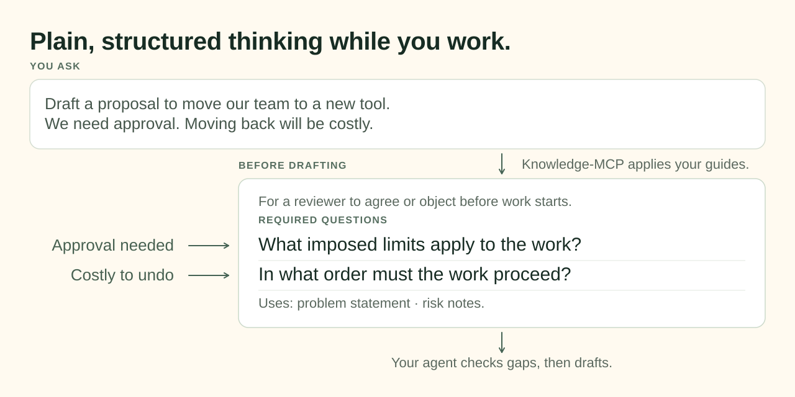

# knowledge-mcp

Plain, structured thinking while you work. It's free, open, and local-first.

## Example

You ask your agent: "Draft a proposal to move our team to a new tool. We need approval. Moving back will be costly."



## Features

- `kb-write-document` skill: before writing or editing a document, your agent gets the document type, the reader and the questions, and records each edit for undo.
- `kb-track-document-types` skill: your agent keeps the document type of each file in `.knowledge-bus/plugins/knowledge-mcp/document-types.yaml` for later sessions.
- `kb-import-document` skill: your agent splits a document written elsewhere, such as a pasted chat thread or a Drive file, into passages and marks each passage against the questions of your document types.
- `kb type <path>`: the document type of a file, at a terminal.
- `kb kbp <mode>`: every kbp mode, such as `kb kbp validate`; kbp is the [knowledge-bus](https://github.com/SterlingJF/knowledge-bus) validator for spec files.
- The six knowledge-bus skills, such as `kb-check` and `kb-ingest`.

## Get started

On macOS, install the MCP server and the kb CLI with [Homebrew](https://brew.sh/):

```sh
brew install sterlingjf/tap/knowledge-mcp
```

Then register knowledge-mcp with each harness you use:

| Harness           | Command                   |
| ----------------- | ------------------------- |
| Claude Code (CLI) | `kb setup claude-code`    |
| Claude (desktop)  | `kb setup claude-desktop` |
| Codex             | `kb setup codex`          |
| Pi                | `kb setup pi`             |
| OpenCode          | `kb setup opencode`       |

Start a new session afterward. For the Claude desktop app, also run the ZIP command that `kb setup claude-desktop` prints and upload each ZIP through Customize → Skills in Claude. Then ask your agent for a document, as in the example above.

### Plugin alternatives

Claude Code and Codex also offer plugin installation. Plugins need [uv](https://docs.astral.sh/uv/), which downloads Python 3.14 when needed. Use one installation route per harness.

Claude Code:

```text
/plugin marketplace add SterlingJF/knowledge-mcp
/plugin install knowledge-mcp@knowledge-mcp
```

Codex:

```sh
codex plugin marketplace add SterlingJF/knowledge-mcp
codex plugin add knowledge-mcp@knowledge-mcp
```

Start a new session after installation.

### Shell completion

For zsh, add to `~/.zshrc`:

```sh
eval "$(_KB_COMPLETE=zsh_source kb)"
```

For Bash 4.4 or later, add to `~/.bashrc`:

```sh
eval "$(_KB_COMPLETE=bash_source kb)"
```

For Fish, add `env _KB_COMPLETE=fish_source kb | source` to your shell configuration.

## Guides and reference

- [MCP tools](docs/mcp-tools.md).
- [Access and data handling](SECURITY.md).
- [Release checks for maintainers](docs/release-check.md).
- [Contributing](CONTRIBUTING.md).

## License

MIT License — see [LICENSE](LICENSE).

The code is open source; the knowledge-mcp name and branding are not. Forks need their own name and branding, with no claim of affiliation.
