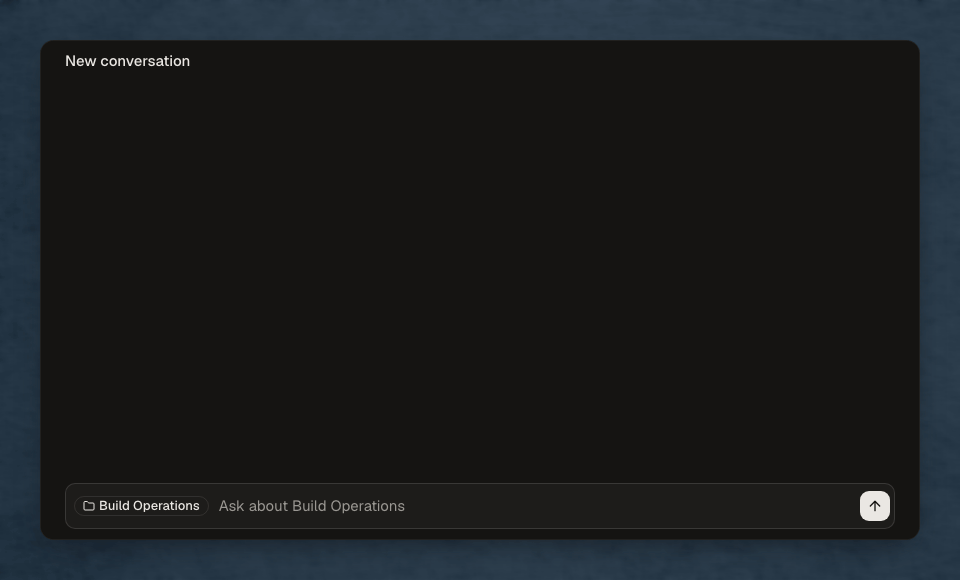

# knowledge-mcp

Plain, structured thinking while you work. It's free, open, and local-first.

## Example

You ask your agent: "Is this ready for review?"



## Key features

- **Document context.** Always keep track of a document's type, dependencies, and target audience. Your agent understands the questions each section should address, from ready-made document types to your own.
- **Suggested edits.** See the evidence behind each proposed change. Suggestions are numbered and list their sources, with how strongly those sources support the change.
- **Knowledge maintenance.** Bring in meeting notes or chat threads and see what they confirm, add to or contradict in your documents. Conflicting answers stay visible and traced for you to easily resolve.
- **File organization.** Set custom rules and patterns for naming and organizing documents. Use an existing folder system like ACE or PARA, or define your own.
- **Persistent memory.** Each document's type, reader and your corrections carry over between chats.
- **Edit history.** See exactly what changed in each recorded edit, and roll back what you don't want.
- **Local-first.** knowledge-mcp runs entirely on-device and can connect to Claude Code, Claude Desktop, Codex, Pi, and OpenCode. No network calls and no account needed.

## Get started

On macOS, install the MCP server and the kb CLI with [Homebrew](https://brew.sh/):

```sh
brew install sterlingjf/tap/knowledge-mcp
```

Then register knowledge-mcp with each harness you use:

| Harness           | Command                   |
| ----------------- | ------------------------- |
| Claude Code (CLI) | `kb setup claude-code`    |
| Claude (desktop)  | `kb setup claude-desktop` |
| Codex             | `kb setup codex`          |
| Pi                | `kb setup pi`             |
| OpenCode          | `kb setup opencode`       |

Then ask your agent about a document, as in the example above.

### Plugin alternatives

Claude Code and Codex also offer plugin installation. Plugins need [uv](https://docs.astral.sh/uv/), which downloads Python 3.14 when needed. Use one installation route per harness.

Claude Code:

```text
/plugin marketplace add SterlingJF/knowledge-mcp
/plugin install knowledge-mcp@knowledge-mcp
```

Codex:

```sh
codex plugin marketplace add SterlingJF/knowledge-mcp
codex plugin add knowledge-mcp@knowledge-mcp
```

### Shell completion

Homebrew installs completions for zsh, Bash and Fish. If you installed `kb` another way, add them yourself.

For zsh, add to `~/.zshrc`:

```sh
eval "$(_KB_COMPLETE=zsh_source kb)"
```

For Bash 4.4 or later, add to `~/.bashrc`:

```sh
eval "$(_KB_COMPLETE=bash_source kb)"
```

For Fish, add `env _KB_COMPLETE=fish_source kb | source` to your shell configuration.

## Guides and reference

- [Introduction](https://knowledge-mcp.pdflowlabs.io/docs).
- [Naming and filing conventions](https://knowledge-mcp.pdflowlabs.io/docs/naming-and-filing).
- [MCP tools](https://knowledge-mcp.pdflowlabs.io/docs/mcp-tools).
- [Access and data handling](SECURITY.md).
- [Release checks for maintainers](RELEASING.md).
- [Contributing](CONTRIBUTING.md).

## License

MIT License — see [LICENSE](LICENSE).

The code is open source; the knowledge-mcp name and branding are not. Forks need their own name and branding, with no claim of affiliation.
